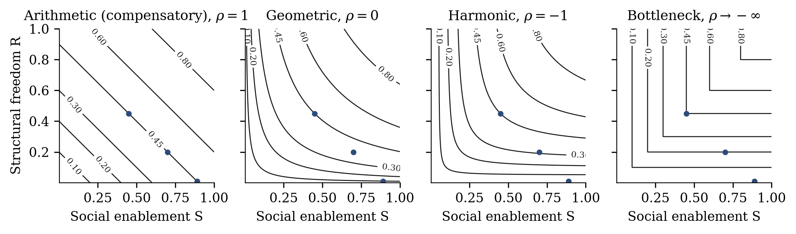
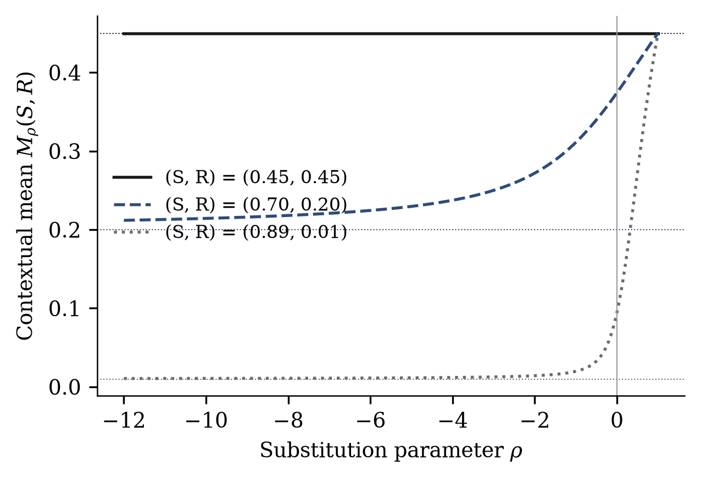
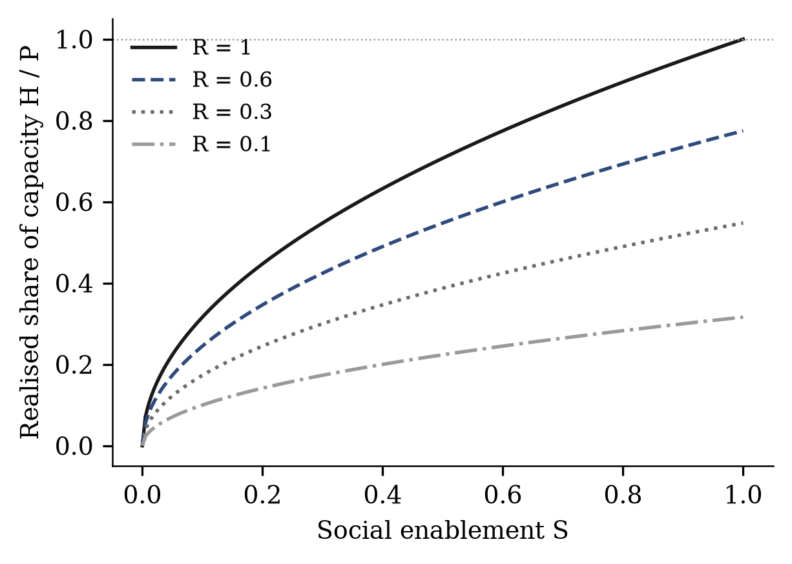
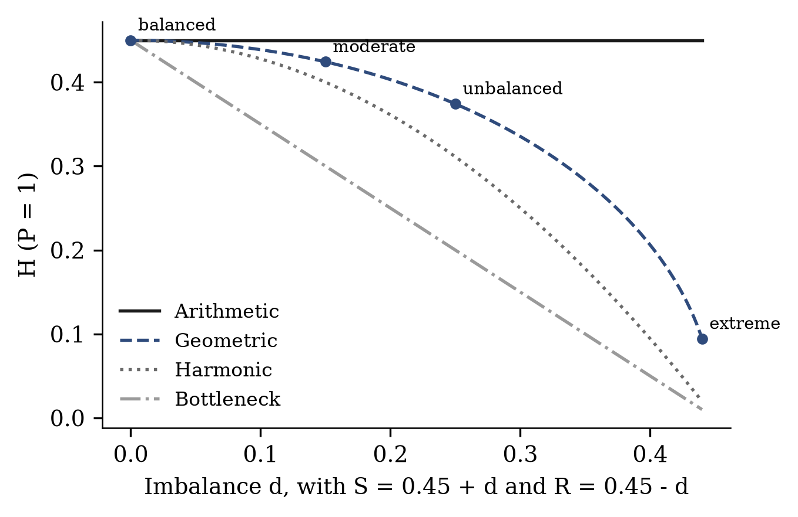
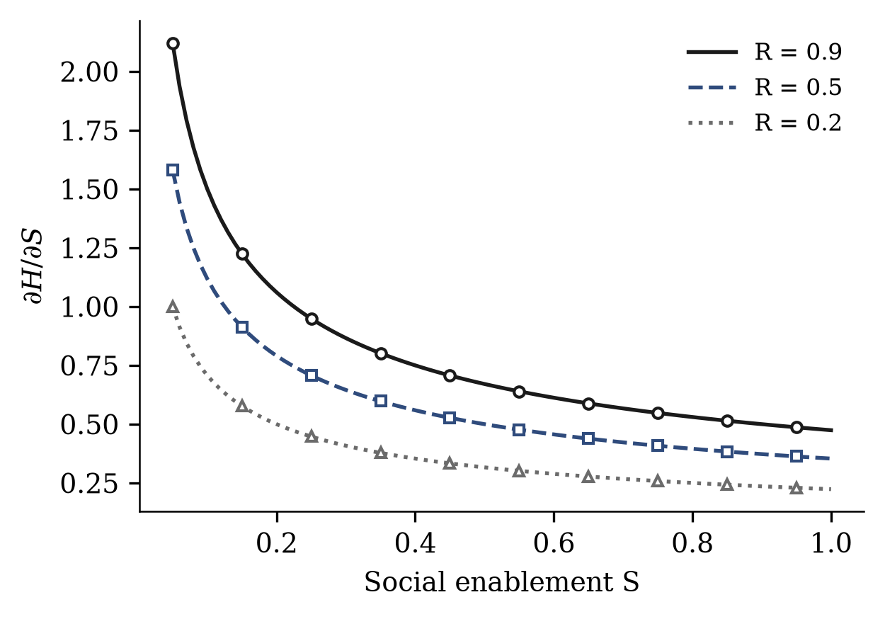
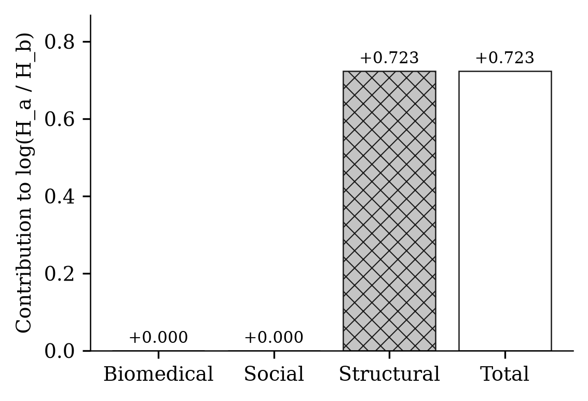
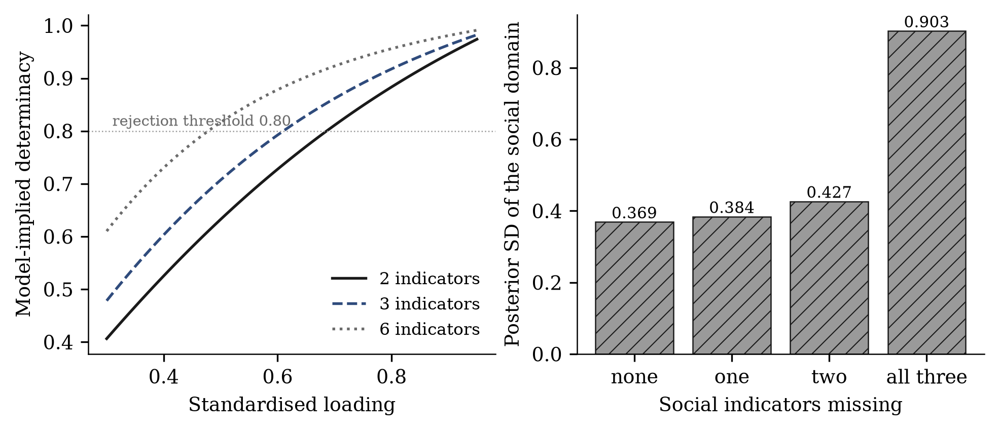
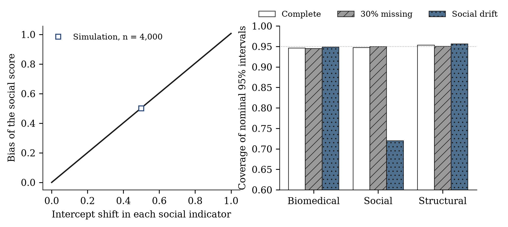
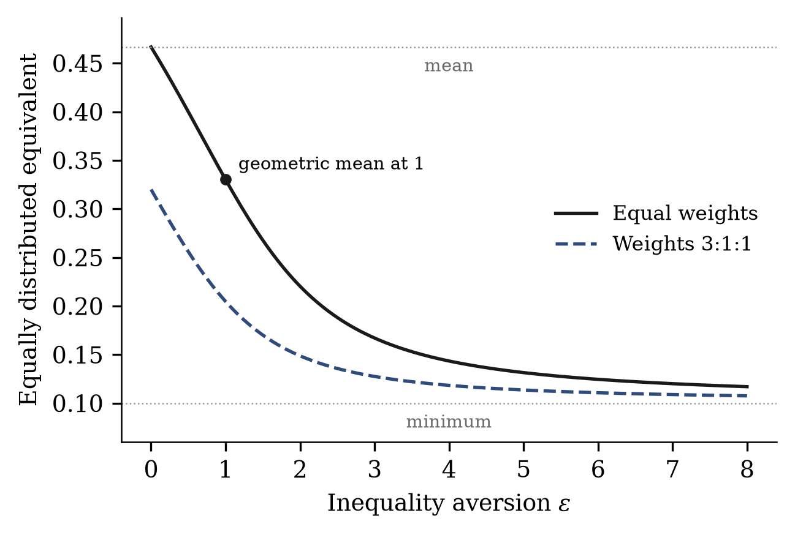
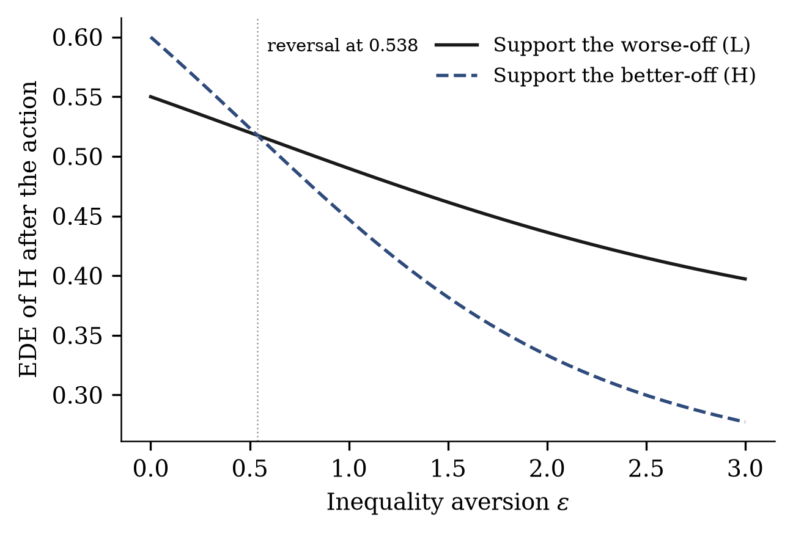

# Proof figures

Each figure shows one result and carries a numeric check that the build enforces.

## proof_01_level_sets (paper 1)

*Result.* For rho <= 0 the contextual mean is zero on each axis (essential domains); only rho > 0 lets one domain compensate for the absence of the other.

Level sets of the contextual mean M(S, R) with equal weights for four members of the CES family. Markers are the three Table 1 profiles with the same arithmetic mean of 0.45. Curved level sets that meet the axes at zero show that a shortfall in one domain cannot be offset by the other.

Check: max |M| on the axes for rho <= 0 (grid starts at 0.001) = 0.0316

## proof_02_ces_family (paper 1)

*Result.* M_rho is non-decreasing in rho, equals the geometric mean at rho = 0, the arithmetic mean at rho = 1, and tends to min(S, R) as rho -> -infinity.

The CES contextual mean against rho for the three Table 1 profiles. Dotted lines mark min(S, R), the bottleneck limit. The balanced profile is flat; the more unbalanced the profile, the more the choice of rho matters.

Check: monotone on the grid = True, |M_-800(0.7, 0.2) - 0.2| = 1.73e-04, geometric at rho = 0 = 0.374166

## proof_03_capacity_ceiling (paper 1)

*Result.* 0 <= H <= P, with H = P only at S = R = 1 and H = 0 when either context domain is zero; H/P does not depend on the unit of P.

Share of biomedical capacity realised, H/P, against social enablement for four levels of structural freedom (P = 30 in arbitrary units). The ceiling at one is reached only with both domains at one.

Check: max H/P = 1.0, H(30,1,1)/30 = 1.0, unit check H(30,.7,.2) = 100 H(.3,.7,.2) = True

## proof_04_balance_penalty (paper 1)

*Result.* At a fixed arithmetic mean of the context, the geometric score falls as the domains move apart (sqrt(0.45^2 - d^2)); the additive score does not move.

H against the gap between the two context domains when their arithmetic mean is held at 0.45. Markers are the Table 1 profiles. Every non-compensatory member penalises imbalance.

Check: geometric at d = 0.25 = 0.3742, closed form sqrt(0.45^2 - 0.25^2) = 0.3742

## proof_05_marginal_effects (paper 1)

*Result.* dH/dS = alpha H / S: the gain from social enablement is largest where S is low and R is high (complementarity, d2H/dSdR > 0).

Analytic marginal effect of social enablement (lines) and central finite differences (open markers) for three levels of structural freedom, P = 1 and alpha = 0.5. The same gain in S is worth more when structural freedom is high.

Check: max |analytic - finite difference| = 1.2e-10

## proof_06_gap_decomposition (paper 1)

*Result.* log(H_a/H_b) = log(P_a/P_b) + alpha log(S_a/S_b) + (1 - alpha) log(R_a/R_b), exactly, with no residual.

Exact log decomposition of the gap between two profiles that differ only in structural freedom (0.85 against 0.20), from results/gap.csv. The whole gap is structural, as it should be.

Check: sum of parts = 0.723459491468, direct log ratio = 0.723459491468

## proof_07_determinacy_and_missingness (paper 2)

*Result.* With a known Gaussian model, determinacy rises with loadings and indicator count, and each missing indicator can only widen the posterior.

Left: model-implied correlation between a single-factor score and its factor, by loading and number of indicators. Right: posterior standard deviation of the social domain in the three-domain synthetic model as its indicators go missing; with all three missing it borrows strength from the correlated domains and stays below the prior SD of one.

Check: determinacy for two unit-loading indicators = 0.816497, sqrt(2/3) = 0.816497, posterior SDs = [0.3692, 0.3842, 0.4268, 0.9029]

## proof_08_measurement_drift (paper 2)

*Result.* A constant intercept shift moves every score by a fixed amount: correlation with the truth is unchanged while bias appears and interval coverage falls.

Left: bias of the posterior social score as the intercepts of the social indicators drift, from the known-model formula (line) and from the 4,000-record simulation at a shift of 0.5 (marker). Right: coverage of 95% posterior intervals by domain and scenario, from results/measurement.csv; the dotted line is the nominal level.

Check: formula bias at 0.5 = 0.5034, simulated bias at 0.5 = 0.5007, simulated social coverage under drift = 0.72

## proof_09_ede_aversion (paper 3)

*Result.* The Atkinson EDE falls from the weighted mean (epsilon = 0) through the weighted geometric mean (epsilon = 1) towards the minimum as epsilon grows; any zero gives EDE = 0 for epsilon >= 1.

EDE of the population (0.1, 0.4, 0.9) against inequality aversion, unweighted and with three times the weight on the worst-off person. Dotted lines are the mean and the minimum.

Check: EDE at 1 = 0.330193, geometric mean = 0.330193, EDE([0,4], 2) = 0.0

## proof_10_allocation_reversal (paper 3)

*Result.* With a fixed budget for one of two actions, the exact allocator's choice reverses once inequality aversion passes the point where the two EDE curves cross.

EDE of H after each single action for the two-person example of Table 1 in paper 3. Below the crossing the larger total gain wins; above it the gain to the worse-off person wins. The exact enumeration in hpotential.crf.allocate picks the higher curve at every tabulated aversion.

Check: crossing epsilon = 0.5381, allocator agrees with the curves = True
